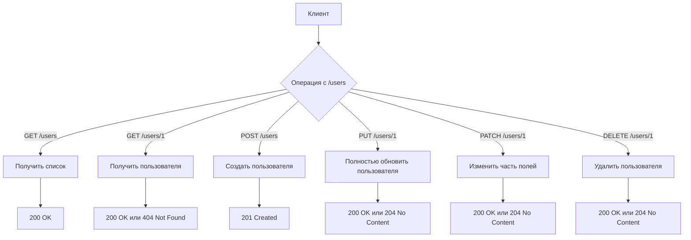

# HTTP вручную, статический сервер и REST API

Учебный проект по теме **HTTP/1.1 и REST API**. В нём собраны все четыре части практической работы:

1. Формирование HTTP-запроса вручную через `netcat`.
2. Статический HTTP-сервер с ответами `200`, `404`, `405` и MIME-типами по расширению файла.
3. REST-клиент: запрос к публичному API, разбор JSON и вывод выбранных полей.
4. Схема CRUD-запросов и ожидаемых HTTP-статусов для ресурса `/users`.

Проект написан на Python 3 и использует только стандартную библиотеку. Устанавливать сторонние пакеты не нужно.

## Содержание репозитория

```text
http-rest-practice/
├── README.md
├── .gitignore
├── examples/
│   ├── crud-examples.md
│   └── manual-http-request.txt
├── public/
│   ├── index.html
│   ├── about.txt
│   └── assets/
│       ├── app.js
│       ├── example.json
│       └── style.css
├── src/
│   ├── __init__.py
│   ├── rest_client.py
│   └── static_server.py
└── tests/
    └── test_static_server.py
```

## Требования

- Python **3.9 или новее**.
- Для первого задания — `netcat` (`nc`). В Windows можно использовать `ncat` из Nmap или выполнить аналогичный запрос через PowerShell.
- Доступ к интернету нужен только для третьего задания, потому что REST-клиент обращается к публичному API.

Проверить версию Python:

```bash
python --version
```

В некоторых системах команда называется `python3`.

---

## Задание 1. HTTP вручную через netcat

HTTP-запрос состоит из стартовой строки, заголовков и пустой строки в конце. В этом задании отправим серверу запрос на главную страницу.

### 1. Запустите статический сервер

Из корневой папки проекта:

```bash
python -m src.static_server
```

По умолчанию сервер слушает `127.0.0.1:8000`. Не закрывайте это окно терминала.

### 2. Откройте второй терминал и отправьте запрос

Linux / macOS:

```bash
printf 'GET / HTTP/1.1\r\nHost: localhost:8000\r\nConnection: close\r\n\r\n' | nc 127.0.0.1 8000
```

Windows с установленным Ncat:

```powershell
$req = "GET / HTTP/1.1`r`nHost: localhost:8000`r`nConnection: close`r`n`r`n"
$req | ncat 127.0.0.1 8000
```

Можно также подключиться интерактивно командой `nc 127.0.0.1 8000`, вставить строки запроса, нажать Enter после заголовка `Host`, затем ещё раз Enter для пустой строки. Для завершения соединения нажмите `Ctrl+C`.

### Пример запроса

```http
GET / HTTP/1.1
Host: localhost:8000
Connection: close

```

Обратите внимание: в реальном HTTP/1.1 между строками используются окончания `CRLF` (`\r\n`), а пустая строка завершает заголовки. Заголовок `Host` обязателен для HTTP/1.1.

### Что должно прийти в ответ

В начале ответа будут примерно такие строки:

```http
HTTP/1.1 200 OK
Content-Type: text/html; charset=utf-8
Content-Length: ...
```

После пустой строки сервер отправит HTML-код страницы. Значение `Content-Length` зависит от размера файла.

---

## Задание 2. Статический HTTP-сервер

Файл реализации: `src/static_server.py`.

Сервер отдаёт файлы из каталога `public/` и поддерживает:

| Ситуация | Ответ | Что означает |
|---|---:|---|
| Файл существует | `200 OK` | Файл найден и отправлен клиенту |
| Файла нет | `404 Not Found` | Запрошенный ресурс не найден |
| Метод не поддерживается | `405 Method Not Allowed` | Разрешены только `GET` и `HEAD` |

Сервер определяет `Content-Type` по расширению файла с помощью `mimetypes`:

- `.html` → `text/html`;
- `.css` → `text/css`;
- `.js` → MIME-тип JavaScript;
- `.json` → `application/json`;
- `.txt` → `text/plain`.

Если тип определить не удалось, используется `application/octet-stream`. Для каталогов сервер ищет `index.html`; список файлов каталога не раскрывается. Также добавлена проверка пути, чтобы запрос не мог выйти за пределы папки `public/`.

### Запуск на другом порту или с другой папкой

```bash
python -m src.static_server --host 127.0.0.1 --port 8080
```

```bash
python -m src.static_server --directory ./public --port 8080
```

После запуска откройте в браузере `http://127.0.0.1:8000/` (или порт, который вы указали).

### Проверка ответов

При работающем сервере можно проверить:

```bash
curl -i http://127.0.0.1:8000/
curl -i http://127.0.0.1:8000/does-not-exist.txt
curl -i -X POST http://127.0.0.1:8000/
```

Ожидаемые статусы: `200`, `404` и `405` соответственно.

---

## Задание 3. REST-клиент и JSON

Файл реализации: `src/rest_client.py`.

Клиент обращается к публичному тестовому API [JSONPlaceholder](https://jsonplaceholder.typicode.com/), получает данные пользователей и разбирает JSON стандартным модулем `json`.

### Получить пользователя с ID 1

```bash
python -m src.rest_client
```

### Получить другого пользователя

```bash
python -m src.rest_client --user-id 3
```

### Получить список всех пользователей

```bash
python -m src.rest_client --all
```

В консоль выводятся поля:

- `id` — идентификатор;
- `name` — имя;
- `username` — имя пользователя;
- `email` — электронная почта;
- `address.city` — город из вложенного объекта `address`;
- `company.name` — название компании из вложенного объекта `company`.

Пример структуры ответа API (сокращённо):

```json
{
  "id": 1,
  "name": "Leanne Graham",
  "username": "Bret",
  "email": "Sincere@april.biz",
  "address": { "city": "Gwenborough" },
  "company": { "name": "Romaguera-Crona" }
}
```

Клиент проверяет HTTP-ошибки, проблемы соединения, тайм-аут и некорректный JSON. Внешние библиотеки вроде `requests` не используются: запрос выполняется через `urllib.request`.

---

## Задание 4. Схема CRUD для `/users`

CRUD — это четыре базовые операции над ресурсом:

- **Create** — создание;
- **Read** — чтение;
- **Update** — изменение;
- **Delete** — удаление.

### Схема вызовов



### Методы и ожидаемые статусы

| Метод | URL | Назначение | Успешный ответ | Возможная ошибка |
|---|---|---|---:|---:|
| `GET` | `/users` | Получить список пользователей | `200 OK` | `500` |
| `GET` | `/users/1` | Получить одного пользователя | `200 OK` | `404 Not Found` |
| `POST` | `/users` | Создать пользователя | `201 Created` | `400 Bad Request` |
| `PUT` | `/users/1` | Полностью заменить пользователя | `200 OK` или `204 No Content` | `404 Not Found` |
| `PATCH` | `/users/1` | Изменить отдельные поля | `200 OK` или `204 No Content` | `404 Not Found` |
| `DELETE` | `/users/1` | Удалить пользователя | `200 OK` или `204 No Content` | `404 Not Found` |

Фактический статус зависит от реализации конкретного API. Например, `201 Created` обычно возвращается при успешном создании, а `204 No Content` означает, что операция успешна, но тело ответа отсутствует.

Подробные примеры запросов с JSON-телами находятся в [`examples/crud-examples.md`](examples/crud-examples.md).

**Важно про JSONPlaceholder:** это демонстрационный API. Он имитирует создание, изменение и удаление и возвращает пример ответа, но изменения не сохраняются как в настоящей базе данных.

---

## Тестирование проекта

В проект добавлены автоматические тесты статического сервера. Они проверяют главную страницу, MIME-тип, ответы `404` и `405`, метод `HEAD` и защиту от выхода за пределы корневой папки.

Из корневого каталога:

```bash
python -m unittest discover -s tests -v
```

Все тесты используют стандартную библиотеку Python и временную папку. REST-тест намеренно не запускается автоматически, чтобы результат тестов не зависел от доступности внешнего API и интернета.

## Как загрузить проект на GitHub

1. Распакуйте архив проекта.
2. Откройте [GitHub](https://github.com/) и создайте новый репозиторий, например `http-rest-practice`.
3. Загрузите **содержимое** распакованной папки в репозиторий. Файл `README.md` GitHub отобразит на главной странице автоматически.
4. Не загружайте виртуальное окружение, кэш Python и временные файлы — они уже исключены в `.gitignore`.

### Краткое описание для репозитория

> Практическая работа по HTTP/1.1 и REST API: ручной HTTP-запрос через netcat, статический сервер на Python, REST-клиент для публичного API и схема CRUD-запросов.

## Ограничения

Это учебный сервер для локальной демонстрации HTTP. Он не предназначен для размещения в интернете или обработки недоверенного трафика в production-среде.
